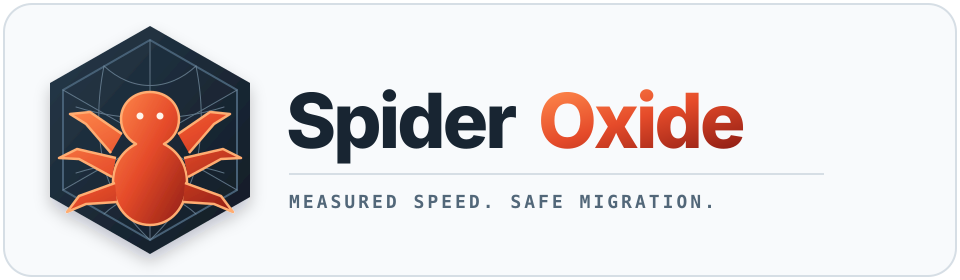

<p align="center">
  <strong>Python-first crawling with a Rust-powered core.</strong><br>
  Build spiders with familiar APIs; choose Python or Rust for the crawl engine and downloader.
</p>

<p align="center">
  <a href="https://github.com/rohankumardubey/SpiderOxide/actions/workflows/ci.yml"></a>
  <a href="https://www.python.org/"></a>
  <a href="LICENSE"></a>
</p>

<p align="center">
  <a href="#quick-start">Quick start</a> ·
  <a href="#why-spideroxide">Why SpiderOxide</a> ·
  <a href="#scrapy-compatibility">Scrapy compatibility</a> ·
  <a href="#documentation">Documentation</a> ·
  <a href="#project-status">Status</a>
</p>

SpiderOxide is an experimental, asynchronous web crawling framework. Write spiders, callbacks,
middleware, and pipelines in Python; use a native Rust engine for scheduling, persistence,
policies, and HTTP transport where it fits your workload. Both engines are checked against the
same behavioral tests.

> [!IMPORTANT]
> SpiderOxide is under active development and is **not yet a drop-in Scrapy replacement**.
> Evaluate it with representative crawls before production use. It is an independent project,
> not affiliated with or endorsed by Scrapy.

## Why SpiderOxide?

| What you need | What SpiderOxide offers |
| --- | --- |
| Familiar development | Python spiders, selectors, middleware, pipelines, settings, and Scrapy-style project commands |
| A native path | Rust scheduling, fingerprinting, duplicate filtering, persistent jobs, policies, and HTTP downloads |
| Explicit control | Select `python`, `rust`, or `auto` for the crawl engine and downloader independently |
| Measurable behavior | Version-pinned Scrapy conformance checks, cross-backend integration tests, and reproducible component benchmarks |

It can export structured data for search, analytics, or downstream AI pipelines; it does not
include browser automation, embeddings, or model inference. Crawl only sources you are permitted
to use, respect site policies and privacy, and review content rights before reusing data.

## Quick start

SpiderOxide supports GIL-enabled CPython 3.10-3.14. For a source checkout, install the development
dependencies and build the native extension with stable Rust and a native build toolchain:

```bash
python3 -m venv .venv
source .venv/bin/activate
python -m pip install -r requirements.txt
python -m maturin develop --release
```

On Windows PowerShell, activate with `.\.venv\Scripts\Activate.ps1`. For tested wheel targets and
release status, see [installation and distribution](docs/INSTALLATION.md).

Create a spider and collect items with the default Python engine:

```python
import asyncio

from spideroxide import Crawler, Spider


class LinkSpider(Spider):
    name = "links"
    start_urls = ["https://example.com/"]

    def parse(self, response):
        for link in response.css("a"):
            yield {
                "text": link.xpath("string(.)").get(),
                "href": link.css("::attr(href)").get(),
            }


result = asyncio.run(Crawler(LinkSpider).crawl())
print(result.items)
```

To select the native engine and downloader, pass
`settings={"ENGINE_BACKEND": "rust", "DOWNLOADER_BACKEND": "rust"}` to `Crawler`.
The [user guide](docs/USER_GUIDE.md) covers runners, settings, middleware, caching, proxying,
feeds, and both backends.

> [!WARNING]
> For Scrapy compatibility, `DOWNLOAD_VERIFY_CERTIFICATES` defaults to `False`. Set it to `True`
> for production crawls unless certificate verification is deliberately handled elsewhere.

## Scrapy compatibility

The optional `spideroxide-scrapy-compat` distribution provides implemented Scrapy **2.19.0**
import paths and the `scrapy` command. It cannot share an environment with upstream Scrapy:
both distributions own the `scrapy` package. The main `spideroxide` package can coexist with
upstream Scrapy for comparisons.

From a source checkout, in an environment without upstream Scrapy:

```bash
python -m pip install ./compat/scrapy
scrapy startproject example
```

See the [compatibility matrix](compat/scrapy/COMPATIBILITY.md) for supported APIs, deviations,
opt-in Twisted features, and limitations. The [conformance suite](conformance/README.md)
compares supported behavior against upstream Scrapy on both engines; the
[third-party certification matrix](certification/README.md) records tested integrations.

## Performance, with context

In a measured **100,000-request component workload**, the Rust combined scheduler flow was
**15.81x faster** than Scrapy 2.17.0. That result excludes networking, parsing, middleware, and
complete crawls; it is **not** a whole-crawler speedup claim. See
[benchmark methodology and results](docs/BENCHMARKS.md) for the environment, raw data, and
reproduction commands.

## Documentation

| Start here | For |
| --- | --- |
| [Installation and distribution](docs/INSTALLATION.md) | Supported platforms, source builds, wheel validation, and release process |
| [User guide](docs/USER_GUIDE.md) | Crawling APIs, settings, backends, middleware, policies, persistence, and exports |
| [Scrapy compatibility](compat/scrapy/COMPATIBILITY.md) | Exact supported version, known gaps, Twisted integration, and migration policy |
| [Benchmarks](docs/BENCHMARKS.md) | Reproducible performance evidence and its limits |
| [Contributing](CONTRIBUTING.md) | Development setup, required checks, and contribution guidelines |

## Project status

CI checks 25 wheels across Linux x86-64/ARM64, macOS x86-64/ARM64, and Windows x86-64 on
CPython 3.10-3.14. Other platforms are not claimed. A full previous-version upgrade is
not yet certified because no earlier release has been published; see the
[distribution support details](docs/INSTALLATION.md#distribution-support).

Full Twisted protocol internals and arbitrary third-party components are outside the
currently supported compatibility surface. Performance evidence covers request-processing
components, not complete network crawls. The Python backend remains available while native
parity and production readiness are evaluated.

## License

SpiderOxide is available under the [MIT License](LICENSE).
